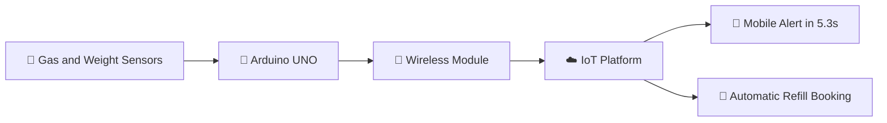

<!-- ============================================================
  GITHUB PROFILE README (v2, enhanced) — Lokesh Pandranki
  HOW TO USE: Create a public repo named exactly "lokesh-pandranki"
  (same as your username), save this file as README.md, and commit.
  Search for "EDIT:" to find parts you may want to update.
============================================================= -->

<!-- ===================== HERO ===================== -->

<!-- EDIT: change the typing lines (separate with ;) -->

  

<!-- Quick navigation -->
[**About**](#-about-me) •
[**Impact**](#-impact-at-a-glance) •
[**Experience**](#-experience) •
[**Projects**](#-featured-projects) •
[**Skills**](#%EF%B8%8F-tech-stack) •
[**Certifications**](#-achievements--certifications) •
[**Contact**](#-lets-connect)

---

<!-- ===================== INTRO VIDEO BANNER ===================== -->
<!-- EDIT: upload assets/intro.gif to your repo (same folder as README.md → assets/intro.gif).
     If your default branch is "master" instead of "main", change "main" in the URL below. -->

<!-- Optional: full-quality video (click to watch) -->
<a href="https://github.com/lokesh-pandranki/lokesh-pandranki/blob/main/assets/intro.mp4">▶️ Watch the full-quality video</a>

---

<!-- ===================== ABOUT ===================== -->
## 👨‍💻 About Me

<!-- EDIT: update your bio any time -->
Electronics and Communication Engineer who turns hardware problems into optimized solutions. I upgrade legacy systems to IoT, design power-efficient VLSI circuits, and build sensor-driven safety networks, like a gas-leak detector with 98.7% accuracy. Currently finishing my B.Tech in ECE and looking for my first role in embedded systems, IoT or VLSI.

<table>
<tr>
<td width="50%" valign="top">

### 🎓 Education
**B.Tech, Electronics & Communication Engineering**
Sanketika Vidya Parishad Engineering College (Andhra University), Visakhapatnam
📅 2022 – 2026 · **CGPA 8.54 / 10**

### 🎯 Career Goals
Seeking a full-time role as an **Embedded Systems, IoT or VLSI Engineer** where I can design reliable hardware, work with sensors and microcontrollers, and help build scalable, data-driven systems. Open to graduate engineer trainee and internship opportunities.

</td>
<td width="50%" valign="top">

### 💡 Interests
- 🔌 Embedded Systems and IoT
- ⚡ VLSI and low-power chip design
- 🚁 Drone and UAV technology
- 🤖 Hardware automation

### 🎲 Fun Fact
Outside of coding, I play **rifle shooting** and **chess**, and I love building electronics projects.

</td>
</tr>
</table>

---

<!-- ===================== IMPACT ===================== -->
## 📈 Impact at a Glance

| 🎯 **98.7%** | ⏱️ **5.3 sec** | 📉 **20%** | 🚁 **25%** | 📰 **1** |
|:---:|:---:|:---:|:---:|:---:|
| Gas leak detection accuracy | Mobile alert time | Less downtime (Vizag Steel Plant) | Faster sensor calibration (UAV) | Peer-reviewed publication |

---

<!-- ===================== EXPERIENCE ===================== -->
## 💼 Experience

<!-- EDIT: add new roles at the top -->

| 📅 When | 🏢 Where | 🔧 What I did | ✅ Result |
|:---|:---|:---|:---|
| **May – Jul 2025** | **HMIES Solutions Pvt Ltd** VLSI Design Intern | Designed and simulated an 8-bit array multiplier in Tanner EDA (90nm) with a custom 1-bit hybrid full adder using Transmission Gate Logic | Lower transistor count and power use, full output voltage swing, faster than conventional CMOS designs |
| **Jan – Feb 2025** | **Vizag Steel Plant (RINL)** Telecom Dept. Intern | Monitored telemetry with SolarWinds/PRTG, maintained Motorola VHF/UHF repeaters, EPABX exchanges and optical fiber nodes, and wrote a Python script to scan telemetry logs into Excel | **Cut downtime by 20%** through proactive repairs |
| **Aug – Oct 2024** | **Rosys Virtual Solutions Pvt. Ltd** Drone Design & Deployment Intern | Worked with the AU-Innovation Center for Drone Technology, integrating sensors and control mechanisms for UAV flight operations | Delivered an autonomous UAV, **cut sensor calibration time by 25%** and improved flight stability |

---

<!-- ===================== PROJECTS ===================== -->
## 🚀 Featured Projects

<!-- EDIT: when you have repo URLs, add a [💻 Code](https://github.com/lokesh-pandranki/REPO) link to each project -->

### 🔥 Smart LPG Gas Monitoring & Automatic Gas Booking System (IoT)
> Arduino-based IoT safety network that tracks gas levels in real time, detects leaks with **98.7% accuracy**, sends mobile alerts in **5.3 seconds**, and automatically triggers refill bookings. **Published in ISJEM (April 2026).**

<!-- System flow (GitHub renders Mermaid diagrams automatically) -->

[📂 Project Proof & Demo](https://drive.google.com/drive/folders/14A2itOUSanzYlZaOq_0zjq8EvPHC9IWm) · [📄 Research Paper (DOI)](https://doi.org/10.55041/ISJEM06210)

 

### 🚗 Wi-Fi Controlled RC Vehicle (Hardware)
> Upgraded a legacy RF-controlled vehicle with an Arduino and ESP8266 module, adding a custom web interface for **100% wireless smartphone control**.

[📂 Project Proof & Demo](https://drive.google.com/drive/folders/18LnLRlOZ6UVrEDbeLIxa8_Zo2nmiiXE7)

 

### ⚡ 8-Bit Array Multiplier with Hybrid Full Adder (VLSI)
> Designed and simulated an 8-bit array multiplier in Tanner EDA (90nm) using a custom 1-bit hybrid full adder based on Transmission Gate Logic, reducing transistor count and power consumption while keeping a full output voltage swing.

[📂 Project Proof & Demo](https://drive.google.com/drive/folders/1-2cRciHBbYUnmuAYo5P4m3RuFbwyCLzU)

 

### 📊 Briefing Desk: Automated Research & Spreadsheet Reporting Tool
> Python tool that processed **50+ vendor records** with error logging for missing fields, enabling spreadsheet-based supplier data verification and import. *(May – Oct 2025)*

---

<!-- ===================== TECH STACK ===================== -->
## 🛠️ Tech Stack

<!-- EDIT: skillicons.io icons: https://skillicons.io — shields badges: https://shields.io -->

<table>
<tr>
<td valign="top" width="50%">

**💻 Languages**
 

**🧰 Tools & Platforms**
 

</td>
<td valign="top" width="50%">

**🔌 Hardware & Microcontrollers**
 

**🎯 Core Domains**
 

</td>
</tr>
</table>

---

<!-- ===================== GITHUB STATS ===================== -->
## 📊 GitHub Stats

<!-- EDIT: change theme=... (see github-readme-stats themes list) -->

 

 

 

---

<!-- ===================== ACHIEVEMENTS ===================== -->
## 🏆 Achievements & Certifications

<!-- EDIT: add new certificates or awards here -->

**📄 Publication**

> *Smart LPG Gas Monitoring and Automatic Gas Booking System on IoT*
> International Scientific Journal of Engineering and Management (ISJEM) · April 2026 · peer-reviewed
> [🔗 DOI: 10.55041/ISJEM06210](https://doi.org/10.55041/ISJEM06210)

**🎓 Certifications**

| Certificate | Issuer |
|:---|:---|
| MS Excel Essentials | Microsoft |
| 4G/5G, IoT Enabling Technologies | Infosys |
| EV Engineering Program | Ford |
| Embedded System Design | Maven Silicon |
| Cybersecurity Analyst Job Simulation | TATA |

---

<!-- ===================== LEARNING & COLLAB ===================== -->
<table>
<tr>
<td valign="top" width="50%">

## 📚 Currently Learning
<!-- EDIT: update as you learn new things -->
- 🔧 Advanced Embedded Systems (RTOS, STM32)
- 🧩 VLSI and Verilog/RTL design
- ☁️ IoT cloud platforms (MQTT, AWS IoT)
- 🐍 Python for data automation

</td>
<td valign="top" width="50%">

## 🤝 Open to Collaborate On
- 🌐 Open-source projects (embedded, IoT and hardware)
- 🔬 Research projects and paper publications
- 💼 Freelance work in IoT, embedded and automation
- 🚀 Startup ideas in IoT and drone technology

</td>
</tr>
</table>

---

<!-- ===================== CONNECT ===================== -->
## 📫 Let's Connect

<!-- EDIT: update links here -->

  

💬 *Open to graduate engineer trainee and internship roles in Embedded Systems, IoT and VLSI. Let's build something great together!*

